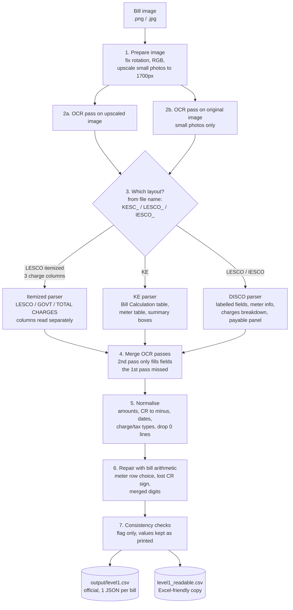
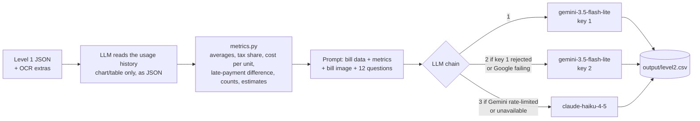

# BillSense: Utility Bill Decoder (WTQ 2026 Build Track)

Reads K-Electric, LESCO and IESCO electricity bill images, extracts the billing details as structured
JSON (**Level 1**), and answers customer questions about each bill in plain English (**Level 2**).

| | |
|---|---|
| **Level 1 (extraction)** | Local OCR (RapidOCR with PaddleOCR models) + layout rules + validation. **No LLM.** |
| **Level 2 (answers)** | `gemini-3.5-flash-lite` (key 1 → key 2), falling back to `claude-haiku-4-5`. Python does all arithmetic. |
| **Runtime** | Python 3.12 (3.11+ works) |
| **Outputs** | `output/level1.csv`, `output/level2.csv`, generated by code from the CSV templates |

---

## Level 1 pipeline



### What each step does

| # | Step | How | Code |
|---|---|---|---|
| 1 | **Prepare image** | Applies EXIF rotation and converts to RGB. Images narrower than 1600 px (phone photos) are upscaled to 1700 px, which recovers digits OCR otherwise misses. | `ocr_extractor.py` · `OcrEngine.prepare` |
| 2 | **OCR** | RapidOCR runs PaddleOCR detection and recognition models locally (ONNX, no network). Every text box comes back with its position. Small photos are read twice (upscaled and original) and results are cached per image. | `OcrEngine.read` |
| 3 | **Layout parsing** | Labels are found by **fuzzy, space-insensitive matching**, because OCR writes `SancLoad` or `Subsidles`. Values are then read to the right of or below the label. **KE:** each row of the *Bill Calculation* table (label + units + rate + amount) is walked in order: charges until the *Electricity Charges* subtotal, taxes until *Taxes and Duties*, then balances. **LESCO/IESCO:** the charges breakdown is a fixed sequence (Total, Subsidies, Net, Taxes, Current Bill). Rows are positioned from the labels found, and values are aligned with a searched vertical offset, because photos often print a value half a row away from its label. **LESCO itemized** (three columns *LESCO CHARGES*, *GOVT. CHARGES*, *TOTAL CHARGES*): each column is read on its own, label by label, up to its TOTAL row. | `parse_ke`, `parse_disco`, `parse_lesco_itemized` |
| 4 | **Merge passes** | The second OCR view only fills fields that are still empty. It never overwrites the first. | `OcrExtractor.extract` |
| 5 | **Normalise** | `Rs. 3,430.24` → `3430.24`, `54770CR` → `-54770`, `3.777.49` → `3777.49`, `080CT26` → `2026-10-08`. Labels map to the allowed types (`FCA :Feb-26` → `fpa`). Lines printed as 0 are dropped and subsidies are made negative. Provider comes from the file name. Only the 18 schema fields are kept, so personal identifiers can never reach the output. | `normalize.py` |
| 6 | **Repair** | **Meter rows:** one row is used directly. With several rows (net metering), only the row whose units equal the billed units is used, otherwise `null`. **Signs:** a payable amount that the bill's own arithmetic shows to be a credit gets its minus sign back. **Merged digits:** `39411/2` read as `3941172` becomes `39411`, but only when Grand Total − Current Bill confirms it. **One misread digit:** a tax total read as `3516` becomes `8516` only when the printed Current Bill − Net Charges equals it and exactly one digit differs. | `resolve_meter_readings`, `repair_credit_signs`, `arrears_value`, `one_digit_repair` |
| 7 | **Checks** | Charges sum = subtotal, charges + taxes = current bill, current bill + arrears = payable, reading − previous = units, date order, required fields present. Failures are **reported, never "fixed"**: the guide asks for values as printed. | `consistency_issues` |
| 8 | **Write CSV** | `level1.csv` keeps the template's columns and row order, with one-line JSON per bill and quotes doubled by Python's `csv` module. A human-readable copy (`level1_readable.csv`) is written next to it. | `csv_io.py`, `readable.py` |

**Design rules**
- **Unreadable means `null`, never a guess.** The guide scores a correct `null` as correct and penalises invented values. Example: a tariff code must match a real tariff pattern (`A-1a(01)`, `A1-R`, …) or it is returned as `null`.
- **Determinism.** The same image always gives the same JSON. There is no model randomness in Level 1.
- **No prebuilt invoice or receipt extractors and no cloud OCR.** Everything after the OCR boxes is our own code.

### Accuracy on the five training bills

| Bill | Fields correct | Not extracted (`null`) |
|---|---|---|
| KESC_0008 | **18/18**, identical to the guide's answer (section 5.7) | — |
| KESC_0004 | 18/18 | — |
| IESCO_0004 | 17/18 | `arrears` (printed `0` not detected by OCR) |
| LESCO_0005 | 17/18 | `tariff` (Urdu text overlaps the code in the photo) |
| LESCO_0006 | 16/18 | `tariff`, `sanctioned_load_kw` |

The reference for KESC_0008 is the guide. The other four were checked manually against the bill images.
No field was extracted with a wrong value; the misses are `null`. The scored test set may differ.

---

## Level 2 pipeline



- **History is read, not counted, by the LLM.** One vision call per bill transcribes the 12/13-month usage chart or table into JSON (month → units). Python then does every count, average and comparison. In testing, letting the model count by itself gave wrong totals.
- **The LLM explains, Python calculates.** Every number an answer needs (averages, differences, counts, percentages, estimates) is pre-computed in `metrics.py`, and the prompt tells the model to use those numbers.
- **Deterministic answers for the 12 fixed questions** (`services/answers.py`): Python writes each answer from the extracted bill and the validated history, with exact figures, month names, labelled estimates and their method. The LLM answers only questions the data cannot answer (for example an FPA month printed only in the Urdu note) and free-form questions from the web UI. Every answer is checked before it is accepted (not empty, English only, no scratch work). A cell is never left empty.
- **History validation** (`services/history.py`): months must be valid, unique and consecutive, none after the bill month, and the current month must match the printed units. If the reading fails these checks, the history region is cropped and read again; rows that still cannot be trusted are dropped rather than guessed. A question the model skipped is retried on its own. A cell is never left empty.
- **Grounding rules in the prompt:** use only the bill, label estimates and say how they were made, state the interpretation used for ambiguous questions, say so when the bill lacks the information, answer in English, and include no personal identifiers.
- **Fallback chain:** Gemini key 1 → Gemini key 2 → Claude Haiku 4.5. Key 2 takes over when key 1 is rejected or Google returns errors. When Gemini is rate-limited the request goes straight to Claude rather than to another Gemini key. The model that answered is recorded for every request.
- **Reliability:** client-side rate limiting, at most 2 retries for transient errors, a 90 s timeout, and an on-disk cache (key = schema version, provider, model, prompt version, prompts and image hash; atomic writes; a corrupt cache file is ignored, never fatal), so re-runs cost no API calls.

---

## Setup

```bash
# from the project folder (the one that contains source/)
python -m venv venv
# Windows: venv\Scripts\activate      macOS/Linux: source venv/bin/activate
pip install -r source/requirements.txt

cp source/.env.example .env   # .env lives next to source/; add your keys (see Configuration)
```

The OCR models ship inside the `rapidocr_onnxruntime` package, so no extra download or system OCR install is needed.


## Run

**Generate the submission CSVs** (Level 1 + Level 2):
```bash
cd source/backend
python run_batch.py --bills ../../test/bills --level1 ../../test/csv/level1.csv --level2 ../../test/csv/level2.csv --out ../../output
```

**Level 1 only, on any folder of bills** (no API key needed):
```bash
python run_batch.py --bills ../../bills --out ../../output_train
```

**One bill** (prints the JSON and saves `<bill_id>.json`, never touching `level1.csv`):
```bash
python run_batch.py --bills ../../bills/KESC_0008.png --out ../../output_train
```

Each batch run writes:

| File | Purpose |
|---|---|
| `level1.csv` | **Official submission file**: template columns, one-line JSON per bill |
| `level2.csv` | **Official submission file**: template columns, answer filled in |
| `level1_readable.csv` | One row per bill, one clearly named column per field (opens well in Excel) |

**Optional web API** (FastAPI, used for single-bill uploads; interactive docs at http://localhost:8000/docs):
```bash
cd source/backend && uvicorn app.main:app --port 8000
```

**Build the submission ZIP** (runs the guide's section 7.8 checklist):
```bash
cd source/backend
python package_submission.py      # writes submission.zip next to source/
```

### API

| Endpoint | Purpose |
|---|---|
| `GET /api/health` | status, Level 1 engine, Level 2 model and fallback |
| `POST /api/extract` | one bill image (multipart `file`) → Level 1 JSON, extras, checks, insights |
| `POST /api/level1/batch` | several images (multipart `files`) → Level 1 JSON per bill + `level1.csv` text |
| `POST /api/ask` | `{"token", "questions": [...]}` → plain-English answers (Level 2) |

## Configuration (`.env` next to `source/`)

| Variable | Purpose | Default |
|---|---|---|
| `MODEL_PROVIDER` | Primary model provider (`google`) | `google` |
| `MODEL_NAME` | Level 2 Gemini model (`gemini-3.5-flash-lite` or `gemini-3.1-flash-lite`) | `gemini-3.5-flash-lite` |
| `API_KEY` | Gemini key 1 (Google AI Studio) | none |
| `GEMINI_API_KEY_2` | Gemini key 2, fallback when key 1 is rejected or Google is failing (`GEMINI_API_KEY2` also accepted) | none |
| `FALLBACK_MODEL_PROVIDER` | Fallback provider (`anthropic`) | `anthropic` |
| `FALLBACK_MODEL_NAME` | Fallback model (only `claude-haiku-4-5` is accepted) | `claude-haiku-4-5` |
| `ANTHROPIC_API_KEY` | Anthropic key for the fallback (`CLAUDE_API_KEY` also accepted) | none |
| `REQUESTS_PER_MINUTE` | Client-side Gemini rate limit | `12` |
| `MAX_RETRIES` | Retries for transient errors | `2` |
| `REQUEST_TIMEOUT_SECONDS` | Per-request timeout | `90` |
| `CORS_ORIGINS` | Browser origin(s) allowed to call the optional web API | `http://localhost:3000` |
| `CACHE_DIR` | Where OCR and LLM responses are cached | `.cache` next to `source/` |

The code refuses any model that is not on the competition's allowed list.

## Project structure

```
project/
├── .env                          real keys (never submitted)
├── output/                       level1.csv, level2.csv (submitted)
├── test/  bills/                 bill images + CSV templates from the organisers
└── source/                       submitted as source/
    ├── README.md
    ├── requirements.txt          Python dependencies, exact versions
    ├── .env.example              every variable the code reads, with placeholders
    └── backend/
        ├── run_batch.py          CLI: bill images + CSV templates → completed CSVs
        ├── package_submission.py builds the competition ZIP and runs the checklist
        └── app/
            ├── main.py           FastAPI app (optional web API)
            ├── api/routes.py     /health, /extract, /level1/batch, /ask
            ├── core/config.py    settings + allowed-model guard
            ├── core/llm.py       LLM chain: Gemini key 1 → key 2 → Claude Haiku 4.5
            └── services/
                ├── ocr_extractor.py  Level 1: image prep, OCR, KE and LESCO/IESCO layout parsers
                ├── normalize.py      schema, value cleaning, repairs, consistency checks
                ├── pipeline.py       orchestration: Level 1 extract, Level 2 history + answers
                ├── metrics.py        deterministic calculations for Level 2
                ├── prompts.py        Level 2 prompt text
                ├── csv_io.py         CSV read/write (guide section 7.2)
                └── readable.py       human-readable CSV exports
```

## Limitations

- **Phone photos:** the tariff code is often hidden by overlapping Urdu text and comes back `null`. A printed `0` can be missed. Both are returned as `null` rather than guessed.
- **New layouts:** the parsers are built for the KE and LESCO/IESCO layouts in the training set. An unseen layout would produce more `null` fields.
- **Usage history** (the 12-month chart) is not part of the Level 1 schema and is not parsed by OCR. For Level 2 it is transcribed by the LLM from the image, so a misread bar value would affect history answers.
- **OCR speed:** about 10–20 s per bill on a laptop CPU. Results are cached per image.

## AI usage

| Category | Used |
|---|---|
| **Models used by the solution** | `gemini-3.5-flash-lite` (Level 2, primary); `claude-haiku-4-5` (Level 2 fallback). Level 1 uses no LLM. |
| **APIs** | Google Gemini API (`google-genai` SDK); Anthropic Messages API (`anthropic` SDK) |
| **Local OCR** | RapidOCR (`rapidocr_onnxruntime`, PaddleOCR models on ONNX Runtime) |
| **Other AI services** | none (no invoice/receipt extractors, no Azure, no cloud OCR, no embeddings) |
| **AI tools used to write the code** | Claude Code (Anthropic) and OpenAI Codex, used as coding assistants |
